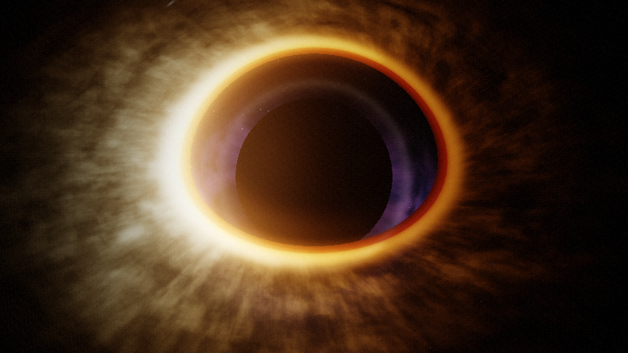
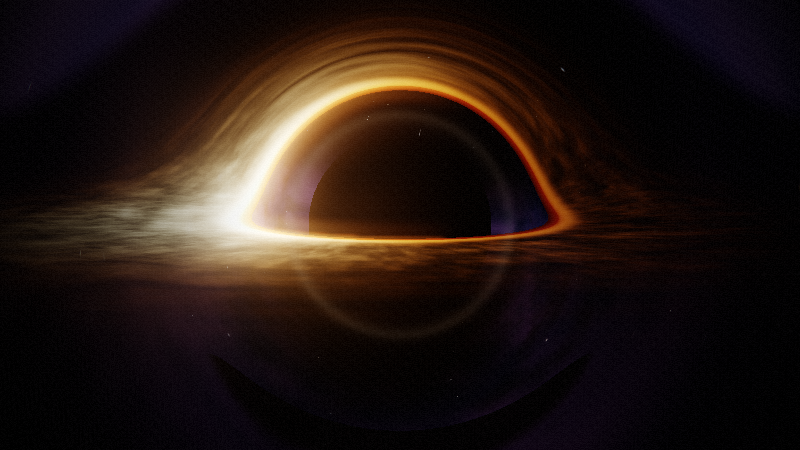
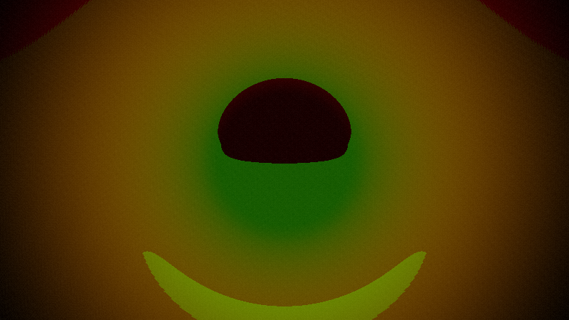
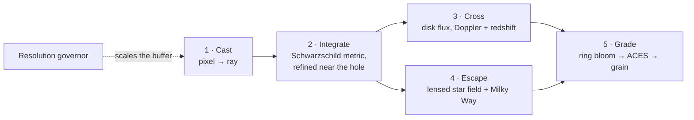

<div align="center">



<p>
  <a href="https://beyond-horizon-omega.vercel.app/explore.html"></a>
  
  
  
</p>

<p><em>A physically based black hole, raytraced live: one null geodesic integrated per pixel, every frame.<br>
No server, no mesh, no pre-rendered footage. Just WebGL2 and plain ES modules.</em></p>

<a href="https://beyond-horizon-omega.vercel.app/explore.html"></a>

</div>



## What it simulates

Beyond Horizon renders a **Schwarzschild black hole**. Each pixel casts a ray and steps it through the curved metric until it falls in, crosses the accretion disk or escapes to the stars. Everything you see, the lensed far side of the disk arching over the shadow, the bright thin photon ring, the stars smeared around the hole, falls out of that one integration. Nothing is painted on.

| | |
|---|---|
| **Gravitational lensing** | The whole background star field and the far side of the disk bend around the hole. |
| **Accretion disk** | A Novikov–Thorne flux model with the inner edge at the ISCO (3 Rs), FBM turbulence, fine streaks and lanes in the inner disk and a smooth haze outside. |
| **Multiple crossings** | A ray may cross the disk plane more than once; opacity accumulates front to back until it saturates. |
| **Relativistic beaming** | The approaching limb blazes blue-white; the receding limb dims to deep red, capped by a tunable Doppler limit. |
| **Gravitational redshift** | Photons climbing out of the well lose energy; colour comes from a pseudo-blackbody ramp. |
| **Photon sphere** | Rays grazing 1.5 Rs wind around the hole and trace the photon ring. |
| **Grading** | Bloom fed only by the photon ring, ACES tone mapping, vignette, film grain and optional chromatic aberration. |

<table>
  <tr>
    <td width="50%"></td>
    <td width="50%"></td>
  </tr>
  <tr>
    <td align="center"><code>2</code> · edge-on, 6° above the disk</td>
    <td align="center"><code>?debug=</code> · inside the integrator</td>
  </tr>
</table>


## The render pipeline




## Measured, not assumed

The first version stuttered. The fix was found by measuring on a real GPU round trip (a 1-pixel `readPixels` per frame; `gl.finish()` returns immediately in Chrome and reports work it never waited for).

| Change | Effect |
|---|---|
| Skip the disk's six FBM evaluations past 18 Rs, where every `mix()` collapses to a constant | Bit-identical output, ~80 % of the disk's area no longer pays for detail it cannot show |
| Return early from the Milky Way band where it cannot reach one 8-bit step after ACES | Two fewer FBM calls for about a third of escaping rays |
| Exact replacements for small `pow()` calls | Small, free, kept |
| Remove a full-screen blend overlay and two `backdrop-filter` panels | 1–2 ms of compositor time back |
| **A resolution governor** that measures frame time and scales only the drawing buffer, by `sqrt(target / measured)` per step | Converges in **2.5 s** instead of drifting for 30; **12.8 → 47 fps** on the test machine |

Step count, bloom and the disk model are never reduced by the governor, so a GPU with headroom keeps the full image. The current buffer scale is shown in the telemetry, so a soft frame is explainable rather than mysterious. Below about 280 steps the shadow edge smears (rays skimming the photon sphere run out of budget), so the landing hero buys its steps out of the pixel budget instead: 300 steps at 0.75 Mpx, paused when scrolled out of view.


## Controls

| Input | Effect |
|---|---|
| Drag | Orbit the black hole |
| Scroll / pinch | Close in or pull back |
| <kbd>1</kbd> | Poster vantage: 24 Rs, 38° above the disk |
| <kbd>2</kbd> | Edge-on: 26 Rs, 6° above the disk |
| <kbd>3</kbd> | Polar: 28 Rs, down the rotation axis |
| <kbd>4</kbd> | Close pass: 9 Rs, 14° |
| <kbd>C</kbd> / <kbd>R</kbd> | Cinematic path (with its soundtrack) · auto orbit |
| <kbd>Q</kbd> | Cycle render profile: Standard (200 steps) → High (320) → Cinematic (460) |
| <kbd>P</kbd> | Open the 21-parameter physics console |

The console exposes geodesic steps, disk inner and outer edge, Doppler cap, near and far opacity, disk and star brightness, sky floor, disk rotation, bloom strength, radius and threshold, vignette, film grain, chromatic aberration, field of view, max distance, orbit speed, the cinematic segment and a debug view.

**URL automation:** `?cam=`, `?steps=`, `?ctime=`, `?debug=`, `?q=`, `?nocine` and `?shot` (deterministic captures that bypass the governor).


## Türkçe özet

**Beyond Horizon**, tarayıcıda gerçek zamanlı çalışan fiziksel bir kara delik ışın izleyicisi. Her piksel için Schwarzschild metriğinde bir ışık yolu (null geodezik) hesaplanıyor. Kütleçekimsel merceklenme, Novikov–Thorne birikim diski, göreli parlama, kütleçekimsel kızıla kayma ve foton küresi canlı olarak çiziliyor. Ölçülerek eklenen bir çözünürlük yöneticisi kare hızını 12,8'den 47 fps'e çıkardı. Sunucu, model dosyası ya da önceden render edilmiş video yok; yalnızca WebGL2 ve sade JavaScript modülleri var.


## Running locally

There is no build step. Serve `beyond-horizon/` from any static server:

```sh
python3 -m http.server 8123 --directory beyond-horizon
# http://localhost:8123/              landing page
# http://localhost:8123/explore.html  simulator
```

```
beyond-horizon/
  index.html     landing page (same geodesic kernel, small budget)
  explore.html   the simulator
  js/            shaders.js (ray + composite passes), main.js (renderer, camera, HUD, console, governor), hero.js
  css/           styles
  audio/         cinematic soundtrack
  vendor/        pinned three.js modules
repair-evidence/ before/after captures
WORKLOG.md       design, performance and verification notes
```

<div align="center">
<br>
<a href="https://github.com/kutluhangil"></a>
<sub>"Do not go gentle into that good night."</sub>
</div>
