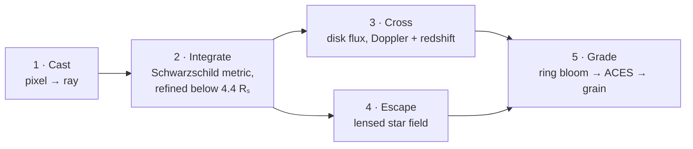

<div align="center">


<p>
  <a href="https://beyond-horizon-omega.vercel.app/explore.html"></a>
  
  
  
</p>

<p><em>A physically based black hole, raytraced live: one null geodesic integrated per pixel, every frame.<br>
No server, no mesh, no pre-rendered footage.</em></p>

<a href="https://beyond-horizon-omega.vercel.app/explore.html"></a>

</div>


## What it simulates

Beyond Horizon renders a **Schwarzschild black hole** with WebGL2 and plain ES modules. Each pixel casts a ray and steps it through the curved metric until it falls in, crosses the disk or escapes to the stars.

| | |
|---|---|
| **Gravitational lensing** | The whole background star field bends around the hole. |
| **Accretion disk** | A Novikov–Thorne flux model with FBM turbulence and inner structure. |
| **Relativistic beaming** | The approaching limb blazes blue-white; the receding limb dims to deep red. |
| **Gravitational redshift** | Photons climbing out of the well lose energy. |
| **Photon sphere** | Rays grazing 1.5 Rₛ wind around the hole and trace the bright photon ring. |
| **Grading** | Bloom fed only by the photon ring, ACES tone mapping, vignette and film grain. |


## The render pipeline




## Controls

| Input | Effect |
|---|---|
| Drag | Orbit the black hole |
| Scroll / pinch | Close in or pull back |
| <kbd>1</kbd> | Poster vantage: 24 Rₛ, 38° above the disk |
| <kbd>2</kbd> | Edge-on: 26 Rₛ, 6° above the disk |
| <kbd>3</kbd> | Polar: 28 Rₛ, down the rotation axis |
| <kbd>4</kbd> | Close pass: 9 Rₛ, 14° |
| <kbd>C</kbd> / <kbd>R</kbd> | Cinematic path · auto orbit |
| <kbd>Q</kbd> | Cycle render profile: Standard → High → Cinematic |
| <kbd>P</kbd> | Open the 21-parameter physics console |


## Türkçe özet

**Beyond Horizon**, tarayıcıda gerçek zamanlı çalışan fiziksel bir kara delik ışın izleyicisi. Her piksel için Schwarzschild metriğinde bir ışık yolu (null geodezik) hesaplanıyor. Kütleçekimsel merceklenme, Novikov–Thorne birikim diski, göreli parlama, kütleçekimsel kızıla kayma ve foton küresi canlı olarak çiziliyor. Sunucu, model dosyası ya da önceden render edilmiş video yok; yalnızca WebGL2 ve sade JavaScript modülleri var.


## Running locally

There is no build step. Serve `beyond-horizon/` from any static server:

```sh
python3 -m http.server 8123 --directory beyond-horizon
# http://localhost:8123/              landing page
# http://localhost:8123/explore.html  simulator
```

```
beyond-horizon/
  index.html     landing page
  explore.html   the simulator
  js/            raytracer, controls, physics console
  css/           styles
  vendor/        pinned third-party modules
```

<div align="center">
<br>
<a href="https://github.com/kutluhangil"></a>
<sub>"Do not go gentle into that good night."</sub>
</div>
